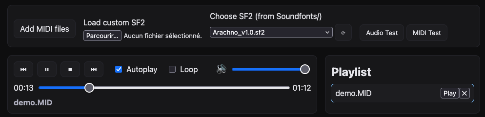

# CBB MIDI Player

🎵 Live demo available [here](https://e-dervieux.github.io/CBB_MIDI_Player/)! 🎵


*(This screenshot may not be up to date with the latest features)*

> **⚠️   Disclaimer   ⚠️**
>
> CBB MIDI Player stands for *Crappy* Browser-Based MIDI Player. *Crappy* because I don't know anything about: web development, javascript (from which I stay as far as possible), the [FluidSynth](https://www.fluidsynth.org/) API, or the [js-synthesizer](https://github.com/jet2jet/js-synthesizer/tree/main) library. I achieved this by heavily relying on CursorAI, and trial-and-error smoke-testing. I *did* try to prompt the AI to make the app more robust though, to comment its code, *etc.*, but the codebase *may* look like heresy for any expert in the field of web-development. Sorry about that.
>
> Feel free to use it at your own risk. I made this mainly for fun, and to have a usable MIDI player at hand, which *(i)* can run on any platform, *(ii)* runs locally and *(iii)* allowed me to use my own soundfonts without significant uploading times (as opposed to many web-based MIDI players that can be found out there). Still I **do** intend to maintain this and fix bugs as they arise so don't hesitate to contribute or report issues in the [issues](https://github.com/e-dervieux/CBB_MIDI_Player/issues) section.


## About

This is a browser-based MIDI player with SoundFont (SF2) support using [js-synthesizer](https://github.com/jet2jet/js-synthesizer/tree/main) (a [FluidSynth](https://www.fluidsynth.org/) WASM port). It includes a playlist, a timeline with play/pause/stop/rewind buttons, autoplay of the next track, and a loop functionnality.

This player comes with the [Microsoft GS Wavetable Synth](https://web.archive.org/web/20250616150719/https://midis.fandom.com/wiki/Microsoft_GS_Wavetable_Synth) soundfont, and a demo MIDI file (main menu music from *Heroes of Might and Magic II*). You may find other soundfonts [here](https://github.com/bratpeki/soundfonts) and [there](https://github.com/ad-si/awesome-soundfonts) if need be ; also check this [Reddit thread](https://www.reddit.com/r/midi/comments/pmh94q/whats_the_best_allaround_soundfont/). I chose to include Microsoft GS Wavetable Synth because it's a good all-around soundfont with a fairly decent size / completeness ratio (only weights 3.2 MB).

## Features
- Playlist of local MIDI files (you can add multiple tracks at once)
- **MIDI file check**: files that may play badly (damaged data, long silent ending, many instrument tracks on one channel, no instrument selection, notes never released, sample-library keyswitches, unsupported SMPTE timing) get a ⚠️ in the playlist; hover it for details
- Load SF2 from file or pick one from the `Soundfonts/` dropdown (there is a folder scan to automatically add SF2 files to the dropdown)
- Timeline/seek, Play/Pause/Stop/Rewind
- **Volume**: ×1 (slider midpoint) is FluidSynth's default gain (0.2), which leaves headroom for dense files; the slider goes from ×0 to ×10, and the orange/red zone warns that loud files may saturate. A soft limiter (linear up to 0.8, tanh shoulder towards 1) keeps the output from hard clipping.
- **Tempo**: a **speed** factor (×0.5–×2), and optionally a custom **base BPM** instead of the file's starting tempo (120 BPM if the file sets none). All tempo changes in the file are scaled together. **Effective BPM** shows the resulting starting tempo. The timeline follows the file's tempo changes and shows times at the current speed.
- **Audio export** (folded section under the playlist): export the current track, or the whole playlist as a `.zip`, to WAV (16/24-bit or 32-bit float), FLAC, MP3 (CBR or VBR), Ogg Opus or Ogg Vorbis, in mono or stereo, at 22.05–96 kHz. Options: apply the current volume and speed, trim long silent endings, and normalize the peak level (per track or across the playlist). Rendering is faster than real time and sounds like playback (same soft limiter, used only when a track would otherwise exceed −0.5 dB, with a recommended volume to avoid it). Encoding uses [libav.js](https://github.com/Yahweasel/libav.js) (FFmpeg compiled to WebAssembly, ~1 MB, downloaded on first export only).
- Autoplay (plays the next track when the current one ends) and **Loop** with a mode: **Track** (repeat the current item) or **Playlist** (advance and wrap at the end of the list). The Track/Playlist choices are disabled until you turn Loop on.
- “Audio Test” (should play a 1 s test tone) and “MIDI Test” (should play a short MIDI test using a piano sound) buttons
- Background-tab safe (will continue playing when the tab is in the background)
- “Low-power” idle: after 30s paused or upon stopping the player, audio graph is suspended/disconnected

## Requirements and installation

In order to run the project locally, you need to have the following installed:

  - Node.js 18+ (for building the project)
  - Python 3 or any static HTTP server (for serving the built app)
  - A modern web browser (e.g. Firefox). Use a server – do **not** open `index.html` via `file://`

### Development Mode

For development with hot-reloading:

```bash
npm install
npm run dev
```

Then open [`http://localhost:8000`](http://localhost:8000) in your browser.

### Production Build

To build and serve the production version:

```bash
npm install
npm run serve
```

This will build the project into the `dist/` folder and serve it at [`http://localhost:8000`](http://localhost:8000).

Alternatively, you can build and serve separately:

```bash
npm run build
python3 -m http.server 8000 --directory dist
```

## Usage

1. **Audio Test** plays a 1s test tone to verify audio output.
2. **Load SF2**:
   - On **GitHub Pages**: The dropdown shows pre-bundled SF2 files from the `sound_data/Soundfonts/` folder
   - **Locally**: The refresh button (⟳) scans for new SF2 files you add to `sound_data/Soundfonts/`
   - You can also load any SF2 file from disk *via* the "Load custom SF2" file input, which will be added to the dropdown, and become available to the player
3. **MIDI Test** plays a short C–E–G arpeggio to verify MIDI playback.
4. **Add MIDI files** to select one or more `.mid`/`.midi` files from your computer.
5. Select a track in the playlist and press **Play**. Available controls:
   - Timeline seek and volume slider
   - **Autoplay**: plays next track when current one ends
   - **Tempo** (under the timeline): speed factor, file or custom base BPM
   - **Loop** + **Track** or **Playlist**: when Loop is on, choose whether the same track repeats or the playlist wraps to the next item after each end
6. **Keyboard shortcuts** (ignored while focus is in a text field, dropdown, or rich-text box):
   - `Space` — play/pause
   - `S` — stop
   - `ArrowRight` / `ArrowLeft` — seek forward / back by **5 seconds**
   - `ArrowDown` — rewind to beginning
7. **Export audio**: open the section under the playlist, choose the options, then **Export current track** or **Export playlist as .zip**. Playback pauses during the export; hover the **?** marks for explanations.

## Known issues

**In rare cases, the string synths do not off**, quickly turning the music into some horrid mess. This is under investigation and I don't know if it's a bug in the library (FluidSynth or its WASM port) or in my code. It might also be a problem in the MIDI files themselves, with no `OFF note` messages...

**SMPTE-timed MIDI files are not supported.** A few MIDI files (mostly made to sync music to video) count time in video frames (SMPTE timing) instead of beats. FluidSynth refuses to load them (see its [source code](https://github.com/FluidSynth/fluidsynth/blob/v2.4.6/src/midi/fluid_midi.c#L373): *"File uses SMPTE timing -- Not implemented yet"*), so they play nothing; the playlist flags them with a ⚠️.

## License

  - Do whatever you want with the code, I hope it works.
  - I don't know the license of the Microsoft GS Wavetable Synth, and put it here for convenience. Rights reserved to the original authors.
  - All praise Paul Romero and Rob King for the sublime soundtrack of *Heroes of Might and Magic II*, all credits is theirs. I included their music as a tribute, no copyright infringement intended.
